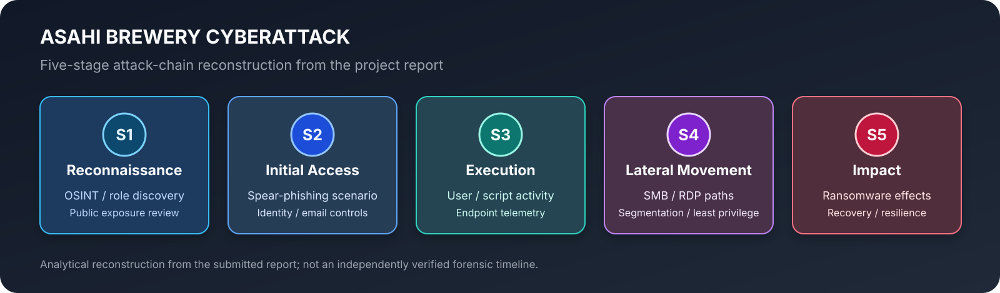
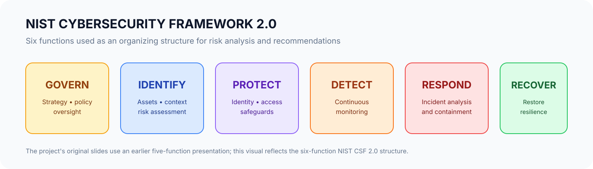
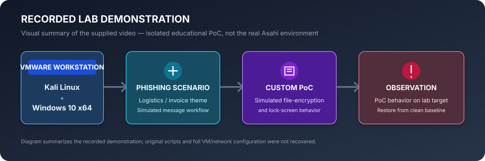
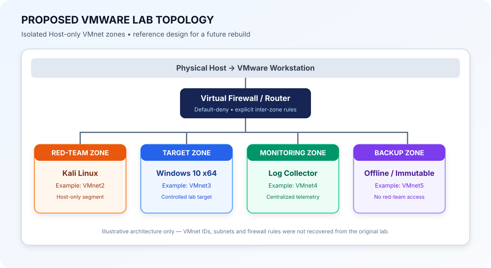
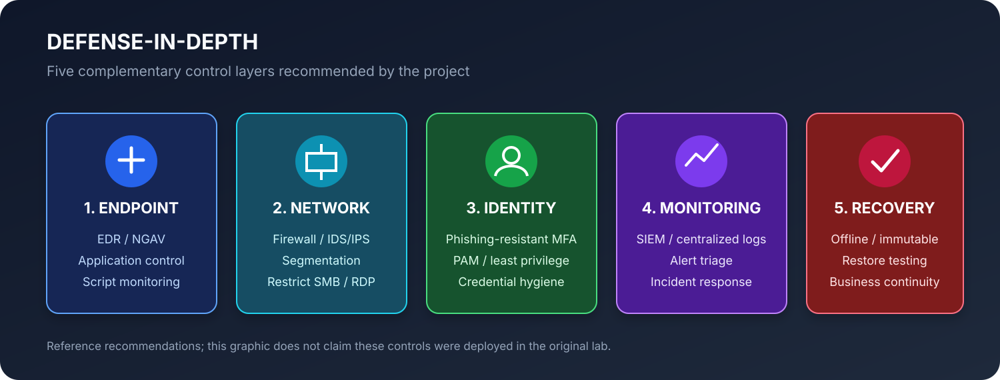

# Asahi Brewery Cyberattack Analysis

**Cybersecurity Case Study · Ransomware Analysis · MITRE ATT&CK · NIST CSF 2.0 · VMware Lab PoC**

> **Recovery notice:** The original project workstation was affected by malware. The original working directory and development files could not be recovered. This repository was reconstructed from the surviving report, presentation PDF, and recorded lab demonstration. It is not a complete recovery of the original source project.

## Project at a glance

This academic project analyzes the 2025 ransomware incident involving Asahi Group Holdings as described in the submitted report and presentation. It studies the reported attack chain, maps selected behaviors to MITRE ATT&CK, evaluates the impact using the CIA Triad and a risk matrix, and recommends controls aligned with NIST Cybersecurity Framework 2.0.

The project also includes a short educational VMware lab demonstration with Kali Linux and Windows 10 x64. The recording shows a logistics-themed phishing scenario and a custom ransomware proof-of-concept (PoC). The PoC is a lab demonstration, **not Qilin's original malware and not a reproduction of Asahi's production network**.

## Quick access to original deliverables

| Deliverable | Link | Format / scope |
|---|---|---|
| Project report | [Open report](https://docs.google.com/document/d/1aTacFKg4T68DmGAslC-MS-hgPeNJAvHQ/edit) | Google Docs · 44-page report |
| Presentation slides | [Open slides PDF](presentations/ASAHI_BREWERY_CYBERATTACK.pdf) | PDF · 16 slides |
| Lab demonstration | [Watch demo video](https://drive.google.com/file/d/1euM46GtrGGJ4G-XNy_ITC11I61_uqxKK/view) | MP4 · approximately 1 min 41 sec |

The report and video remain at the Google Drive / Google Docs locations supplied for the project. Access to those external links depends on their sharing permissions. The slide PDF is stored directly in this repository under `presentations/`.

## Visual overview

### Attack-chain analysis

The attack-chain graphic is a high-level analytical reconstruction from the submitted report. It should not be interpreted as a forensic timeline independently verified from Asahi's internal telemetry.

### MITRE ATT&CK, risk assessment, and NIST CSF

The report also contains MITRE ATT&CK technique mapping, a CIA Triad assessment, and a 5 × 5 likelihood-impact risk matrix. See [docs/attack-chain-and-mitre.md](docs/attack-chain-and-mitre.md) and [docs/risk-assessment.md](docs/risk-assessment.md).

### Recorded lab demonstration

The original MP4 is available here: [Watch the lab demonstration](https://drive.google.com/file/d/1euM46GtrGGJ4G-XNy_ITC11I61_uqxKK/view).

### Screenshot from the surviving demo

Still extracted from the supplied MP4. Student alias and payment/contact details are redacted. The screen is a simulated PoC display, not evidence of Qilin malware or access to Asahi systems.

### Proposed VMware lab segmentation

This is a **proposed reference design for a future rebuild**, not the original VMnet/VLAN configuration. The original IP addresses, VMnet assignments, VLAN IDs, firewall rules, and backup configuration were not recovered.

### Defense-in-Depth recommendations

These are defensive recommendations, not controls that the project claims were deployed at Asahi or in the original lab.

## Project objectives

1. Describe the business and IT/OT context of the Asahi case study.
2. Reconstruct the reported attack lifecycle from reconnaissance to ransomware impact.
3. Map selected behaviors to MITRE ATT&CK.
4. Assess confidentiality, integrity, and availability using the CIA Triad.
5. Prioritize risks through a likelihood-impact matrix.
6. Review defensive gaps through NIST CSF 2.0.
7. Recommend layered controls across identity, endpoint, network, monitoring, incident response, and recovery.
8. Preserve the surviving deliverables and document the known limits of the recovered project.

## What the demo recording shows

The supplied recording visibly includes:

- VMware Workstation with Kali Linux and Windows 10 x64 virtual machines.
- A Kali-side demonstration workflow using Metasploit tooling.
- A logistics/shipping-invoice-themed phishing email scenario.
- A Windows-side custom PoC screen illustrating simulated file encryption and system-lockdown behavior.

The video demonstrates a controlled educational workflow only. It does not prove that the same tools, payloads, indicators, commands, or infrastructure were used by the attackers against Asahi. See [demo/README.md](demo/README.md) for the demo scope and safety notes.

## Repository structure

~~~text
asahi-brewery-cyberattack-analysis/
├── README.md
├── assets/
│   ├── README.md
│   ├── diagrams/
│       ├── attack-chain.svg
│       ├── demo-workflow.svg
│       ├── defense-in-depth.svg
│       ├── lab-topology-proposed.svg
│       └── nist-csf.svg
├── demo/
│   └── README.md
├── docs/
│   ├── README.md
│   ├── attack-chain-and-mitre.md
│   ├── lab-environment.md
│   ├── proposed-infrastructure.md
│   ├── recovery-and-limitations.md
│   ├── risk-assessment.md
│   ├── upload-guide.md
│   └── vmware-workstation-setup.md
├── presentations/
│   ├── README.md
│   └── ASAHI_BREWERY_CYBERATTACK.pdf
└── reports/
    └── README.md
~~~

## Main topics covered

- **Attack Chain:** reconnaissance, initial access, execution, lateral movement, and impact.
- **MITRE ATT&CK:** technique mapping for phishing, scripting, remote services, defense evasion, exfiltration, and impact.
- **CIA Triad:** confidentiality, integrity, and availability.
- **Risk Matrix:** likelihood and impact prioritization.
- **NIST CSF 2.0:** Govern, Identify, Protect, Detect, Respond, and Recover.
- **Defense-in-Depth:** endpoint, network, identity, monitoring, and recovery layers.
- **Infrastructure design:** proposed isolated VMnet zones, firewall policy, logging, and backup/restore.

## Important recovery limitations

The following original materials were not recovered and are not represented as implemented:

- Original source code, scripts, and build files.
- VMware VM exports, snapshots, and exact virtual hardware settings.
- Original VMnet mode, VLAN IDs, IP addressing, routing, and firewall configuration.
- SIEM/log collector setup and original event logs.
- Backup destination, retention, isolation, and restore-test evidence.

The proposed network and backup design in `docs/` is clearly labelled as a future/reference design. Example VMnet IDs and IP subnets are illustrative only.

The submitted report's limitations section says that a practical attack simulation had not been performed, while the separate surviving video shows a lab PoC. This repository treats the video as a supplementary educational demonstration and does not present it as a reproduction of the real Asahi incident.

## Privacy and responsible use

- The source DOCX report contains student names and student identification numbers. The original report is therefore linked through its existing Google Docs location instead of being copied into the public repository. Confirm sharing permission with all contributors before making the Google Doc public.
- Do not upload the separate IT Infrastructure résumé; it contains personal contact information.
- This is an academic case study based on public information and submitted project materials, not an official Asahi forensic report.
- Some incident figures in the report and slides are estimates or time-dependent. Preserve their original context and verify primary sources before reusing them externally.
- Use the lab demonstration only in an isolated, authorized environment. Do not execute payloads or test against third-party systems.

## Project team

The original report lists the following student contributors:

- Tiêu Hoàng Phúc
- Nguyễn Nam Trường
- Nguyễn Phú Đạt

Instructor: ThS. Phan Đình Duy Thông  
Institution: Ho Chi Minh City University of Technology (HUTECH)  
Original report and presentation: 2025

---

**Repository status:** recovered presentation PDF, reconstructed technical documentation, and original external links to the report and demo are organized in this repository.
