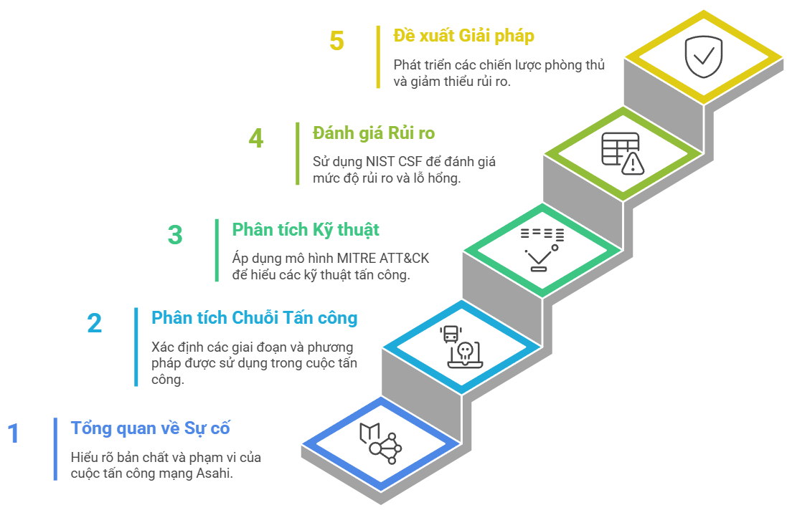
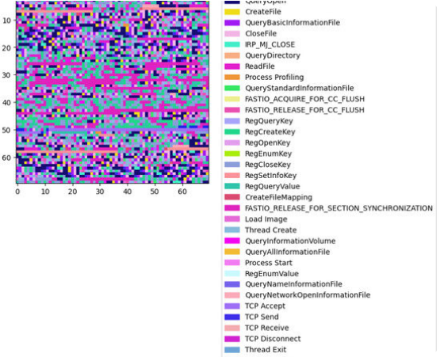
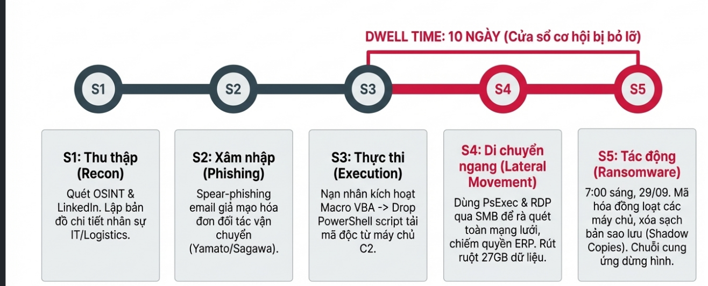
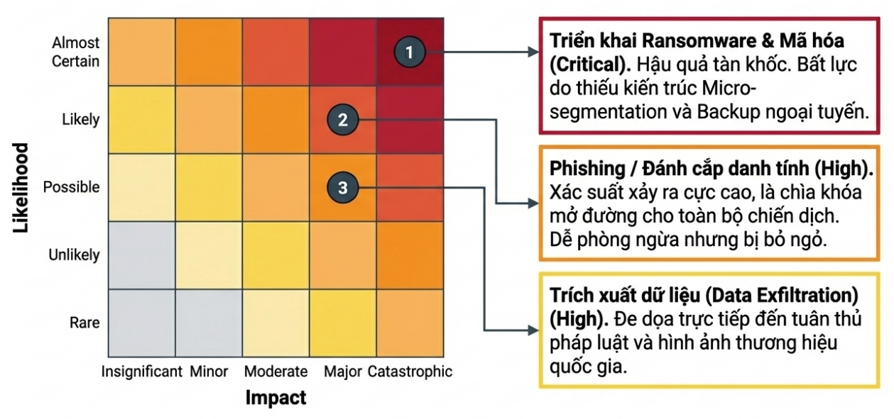
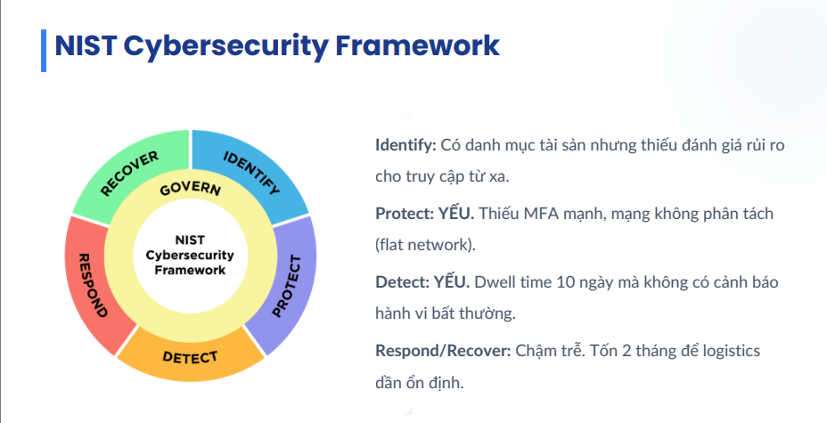
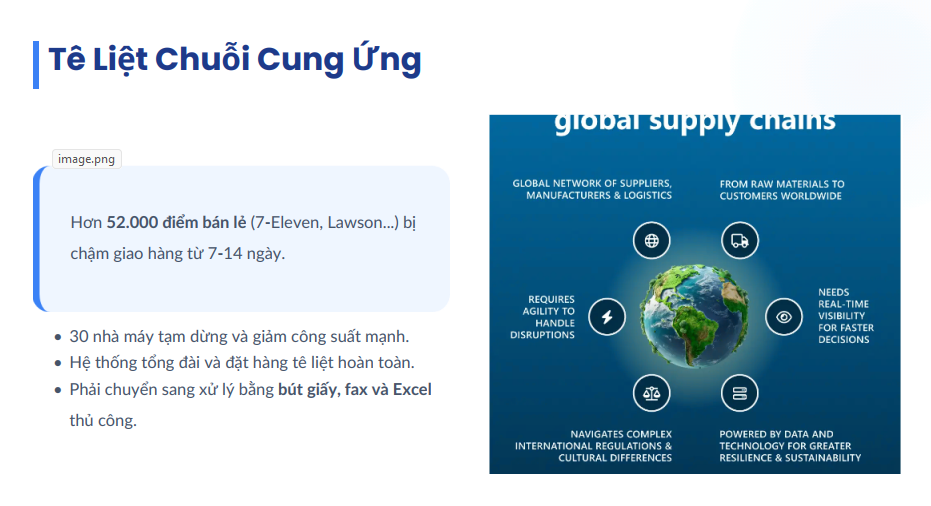
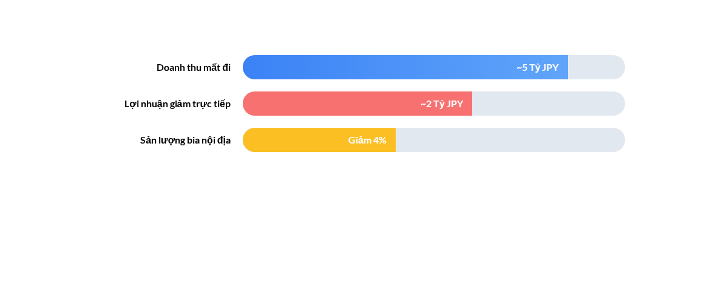
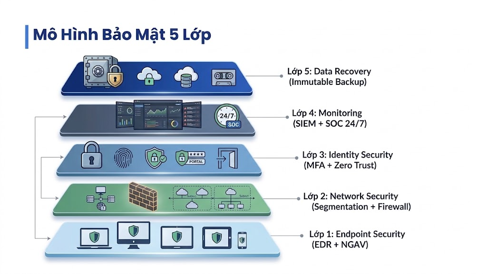

<p align="center">
  
  
  
  
  
</p>

# 🍺 Asahi Brewery Cyberattack — Threat Analysis, Risk Assessment & Ransomware Simulation

A comprehensive cybersecurity case study analyzing the **September 2025 Qilin Ransomware double-extortion incident against Asahi Group Holdings**, mapped to the **Cyber Kill Chain**, **MITRE ATT&CK**, **CIA Triad**, and **NIST Cybersecurity Framework (CSF 2.0)**, paired with an isolated VMware Spear-Phishing & Ransomware lab demonstration.

> [!NOTE]
> **📌 Repository & Archive Notice:**
> Due to a local workstation malware incident during post-lab cleanup, the original raw VMware virtual machine snapshots, source scripts, and compiled PoC binaries were lost. Only the recovered PDF presentation slides, full Word technical report, reconstructed lab commands, and recorded video demonstration are preserved in this repository.
>
> *Do sự cố máy tính cá nhân bị nhiễm virus trong quá trình dọn dẹp môi trường lab, toàn bộ file máy ảo gốc, mã nguồn và binary PoC đã bị mất. Repository này chỉ lưu giữ bản báo cáo Word, slide thuyết trình PDF, kịch bản lệnh tái dựng và video demo.*

---

## 📑 Table of Contents

- [Live Demo](#-live-demo)
- [Project Documentation](#-project-documentation)
- [Case Study Overview](#-case-study-overview-asahi-group-holdings-incident-sept-2025)
- [Attack Chain & MITRE ATT&CK Mapping](#%EF%B8%8F-attack-chain--mitre-attck-mapping)
- [CIA Triad Assessment](#-cia-triad-assessment)
- [Risk Assessment](#-risk-assessment-5×5-matrix--nist-csf-20)
- [Business Impact Analysis](#-business-impact-analysis)
- [Lab Attack Simulation](#-lab-attack-simulation)
- [Proposed Defense-in-Depth Architecture](#%EF%B8%8F-proposed-5-layer-defense-in-depth-architecture)
- [Key Takeaways](#-key-takeaways)
- [References](#-references)
- [Authors & Academic Context](#-authors--academic-context)
- [License](#-license)

---

## 🎥 Live Demo

**Recorded Lab Walkthrough:** [`demo/Demo_Full.mp4`](demo/Demo_Full.mp4)
*(1 min 40 sec — End-to-end Spear-Phishing delivery → Meterpreter C2 session → Ransomware file encryption)*

> **Tip:** On GitHub, you can drag and drop the video file into this section when editing to render an inline playable video widget.

### Evidence Visible in the Demo

The supplied MP4 is approximately 1 minute 41 seconds long, at 1780 × 1080 pixels, and records at 30 frames per second.

| Item | Observation |
| :--- | :--- |
| Virtualization platform | VMware Workstation |
| Virtual machine 1 | Kali Linux |
| Virtual machine 2 | Windows 10 x64 |

> **Archive limitation:** Detailed VM configuration and original snapshots were not recovered. This table lists only evidence directly visible in the demo; reconstructed or inferred configuration is clearly identified in the lab walkthrough.

---

## 📄 Project Documentation

| Document | Description |
| :--- | :--- |
| 📚 [Documentation Index (`docs/`)](docs/README.md) | Complete index of detailed technical markdown documents (`attack-chain-and-mitre.md`, `risk-assessment.md`, `proposed-infrastructure.md`, `lab-environment.md`, `vmware-workstation-setup.md`, `recovery-and-limitations.md`, `upload-guide.md`) |
| 📊 [Presentation Slides (PDF)](docs/ASAHI_BREWERY_CYBERATTACK_Slides.pdf) | 30+ slides covering full analysis, diagrams, and defense proposals |
| 📝 [Full Technical Report (DOCX)](docs/Bao_Cao_ASAHI_BREWERY_CYBERATTACK.docx) | 40-page academic report with detailed analysis (Vietnamese) |
| 🔬 [Lab Walkthrough & Metasploit Script](lab-simulation/lab-walkthrough.md) | Reconstructed attack simulation steps & `handler.rc` |

---

## 🎯 Case Study Overview: Asahi Group Holdings Incident (Sept 2025)

On **September 29, 2025 (07:00 JST)**, **Asahi Group Holdings** — Japan's largest beer manufacturer (~40% domestic market share) — suffered a large-scale double-extortion ransomware attack attributed to the **Qilin (Agenda) RaaS** group, resulting in one of the most disruptive supply-chain cyber incidents in Japan's beverage manufacturing sector.



### Incident Summary

| Metric / Dimension | Incident Impact Details |
| :--- | :--- |
| **Threat Actor** | **Qilin (MITRE Group G1242)** — Modular Golang/Rust RaaS platform (XChaCha20 encryption), 700+ attacks claimed in 2025 |
| **Initial Access Vector** | Spear-phishing targeting IT & Logistics personnel + stolen valid credentials on network equipment |
| **Dwell Time** | **~10 Days** (Sept 19 – Sept 29, 2025) of undetected off-hours internal reconnaissance & pivoting |
| **Operational Disruption** | **30 factories** halted/reduced; **52,000+ retail outlets** (7-Eleven, Lawson, FamilyMart) delayed 7–14 days; ~2 months manual fallback (paper, fax, Excel) |
| **Data Exfiltration** | **27 GB** internal corporate data stolen; **115,513 confirmed leaked records** (1.914M records at risk) |
| **Financial Impact** | **~¥10–15 Billion (~$94M USD)** total estimated loss; ~¥5B direct revenue loss; ~¥2B direct profit drop; −4% annual domestic beer volume; ransom refused |

### Incident Timeline

```
Sept 19, 2025     Estimated initial compromise (foothold via stolen credentials)
     │
     ▼  ~~10 days of undetected lateral movement (off-hours activity)~~
     │
Sept 29, 07:00    Ransomware detonated simultaneously across data center
Sept 29, 11:00    Network isolation begins (~4 hours response delay)
Sept 29           Asahi public disclosure
     │
Oct 7-9           Qilin claims responsibility on dark web leak site
Oct 2025          Production gradually restarts (manual, 10-25% capacity)
     │
Nov 27, 2025      Asahi investigation report: 1.914M records at risk
     │
Feb 18, 2026      Asahi update: 115,513 records confirmed leaked
Feb 2026          Logistics normalization begins
```



---

## ⚔️ Attack Chain & MITRE ATT&CK Mapping

The attack followed a classic **5-stage kill chain**, exploiting well-known techniques without any zero-day exploits — highlighting fundamental security gaps.



### Stage-by-Stage Breakdown

<details>
<summary><b>S1: Reconnaissance</b> — OSINT & Organization Mapping</summary>

**MITRE Techniques:** `T1589` (Gather Victim Identity), `T1591` (Gather Victim Org Information)

The reconnaissance phase was systematic and lasted approximately 10 days:

- **Email Harvesting:** Collected hundreds of public email addresses (format: `name.surname@asahi.com`) from annual reports, press releases, and public PDFs
- **Organizational Mapping:** Built complete org charts of critical departments (IT Infrastructure, Supply Chain & Logistics, Production Control, Finance & Accounting) from integrated reports and corporate website
- **Technology Profiling:** Identified ERP (SAP-based), WMS/TMS logistics systems, and VPN/router equipment from LinkedIn job postings
- **LinkedIn OSINT:** Created detailed target lists of IT and Logistics personnel with names, roles, experience, and recent posts
- **Google Dorking:** `site:asahigroup-holdings.com filetype:pdf "email"`, `"Asahi" "ERP administrator"`, `inurl:admin filetype:xls`
- **Passive DNS:** Enumerated subdomains (`erp.asahi.jp`, `logistics.asahi.co.jp`, `vpn.asahi.group`)

**Key Insight:** Attackers precisely identified two target groups:
1. **IT Staff** (Network Engineers, Sys Admins) → held network equipment credentials
2. **Logistics Staff** (Supply Chain Managers, Warehouse Operators) → used ERP daily, credentials easily phished

</details>

<details>
<summary><b>S2: Delivery & Initial Access</b> — Spear-Phishing & Credential Theft</summary>

**MITRE Techniques:** `T1566.001` (Spearphishing Attachment), `T1566.002` (Spearphishing Link), `T1078.002` (Valid Domain Accounts)

The initial access phase used highly targeted spear-phishing:

- **Fake Partner Emails:** Impersonated Yamato Transport and Sagawa Express with urgent subject lines:
  - *"September Shipping Invoice Update — Confirm Immediately"*
  - *"Emergency Delivery Schedule Change — Asahi Super Dry"*
- **Malicious Attachments:** `.docx` / `.xlsm` files disguised as order lists, shipping contracts, inventory reports
- **Credential Phishing:** Fake Microsoft 365 / VPN login pages (domains like `asahi-login.com`, `asahigroup-secure.net`) with fake CAPTCHA for credibility
- **MFA Fatigue:** Continuous push notification bombardment until employees approved
- **Result:** Valid credentials obtained → VPN/remote access to network equipment at a Group site

> *"Unauthorized access occurred through network equipment at one of the Group's sites, utilizing stolen credentials."* — Asahi Official Report, Nov 27, 2025

</details>

<details>
<summary><b>S3: Execution & Persistence</b> — Malware Deployment</summary>

**MITRE Techniques:** `T1204.002` (User Execution), `T1059.001` (PowerShell), `T1547.001` (Registry Run Keys), `T1053.005` (Scheduled Task), `T1562.001` (Disable/Modify Tools)

Upon opening malicious files:

1. **VBA Macro Execution:** Obfuscated macros (base64/string concatenation) triggered by "Enable Content"
2. **PowerShell Dropper:** Obfuscated script (Invoke-Obfuscation) → bypassed AMSI → downloaded Qilin dropper from C2
3. **Process Injection:** Dropper disguised as `update.exe` / `invoice_processor.dll` injected into `explorer.exe` / `svchost.exe`
4. **C2 Establishment:** Outbound HTTPS / DNS tunneling connection to Qilin infrastructure
5. **Payload Staging:** Gradually downloaded Mimikatz, PsExec, Cobalt Strike beacon, and ransomware binary (Golang/Rust)
6. **Persistence:** Registry run keys + scheduled tasks (e.g., `TVInstallRestore`)

</details>

<details>
<summary><b>S4: Lateral Movement</b> — Internal Network Traversal</summary>

**MITRE Techniques:** `T1003.001` (LSASS Memory Dump), `T1021.002` (SMB/Admin Shares), `T1021.001` (RDP)

Over 10 days, the attacker moved laterally across the flat network:

- **Credential Dumping:** Mimikatz `sekurlsa::logonpasswords` → harvested domain admin and service account credentials
- **SMB Lateral Movement:** PsExec (renamed to random filenames like `vvvivyyl.exe`) → executed payloads on remote servers via port 445
- **RDP Pivoting:** Direct login to servers via port 3389 using domain admin credentials, primarily during off-hours
- **Network Mapping:** Nmap scans (ports 135, 445, 3389) + Active Directory enumeration
- **Pivot Path:** User PC → Domain Controller → File Server → ERP Server → MES/SCADA (OT systems)

**Critical Failure:** Flat IT/OT network architecture allowed unrestricted movement from corporate IT to 30 manufacturing plant control systems.

</details>

<details>
<summary><b>S5: Exfiltration & Impact</b> — Double Extortion</summary>

**MITRE Techniques:** `T1041` (Exfiltration Over C2), `T1490` (Inhibit System Recovery), `T1486` (Data Encrypted for Impact)

The final stage executed at 07:00 JST on September 29, 2025:

1. **Data Exfiltration:** 27 GB of internal data (financial documents, contracts, employee/customer PII) exfiltrated to Qilin's infrastructure before encryption
2. **Recovery Inhibition:** `vssadmin delete shadows /all /quiet` → wiped all Volume Shadow Copies; online backup systems tampered
3. **Simultaneous Encryption:** Qilin ransomware (XChaCha20) deployed across dozens of active servers and PCs in the data center
4. **Ransom Note:** *"Your files are encrypted. Contact us on Tor for decryption key."*
5. **Dark Web Publication:** 29 sample images of internal documents posted on Qilin's leak site (Oct 7-9, 2025)
6. **Asahi's Response:** Refused to pay ransom

</details>

### Full MITRE ATT&CK Technique Mapping

| Kill Chain Stage | MITRE Tactic | Technique ID & Name | Observed TTP in Asahi Incident | Evidence Source |
| :--- | :--- | :--- | :--- | :--- |
| **S1** | Reconnaissance | `T1589` / `T1591` OSINT & Org Mapping | LinkedIn profiling, Google Dorking, subdomain enum | Qilin TTPs |
| **S2** | Initial Access | `T1566.001` Spearphishing Attachment | Fake Yamato/Sagawa invoices (`.xlsm`/`.docx`) | Asahi Report 27/11 |
| **S2** | Initial Access | `T1566.002` Spearphishing Link | Fake M365/VPN login portals | Qilin TTPs |
| **S2** | Initial Access | `T1078.002` Valid Domain Accounts | Stolen credentials → network equipment access | Asahi Official |
| **S3** | Execution | `T1204.002` User Execution: Malicious File | VBA macros → PowerShell dropper | MITRE S1242 |
| **S3** | Execution | `T1059.001` PowerShell | Obfuscated PS scripts, AMSI bypass | Qilin Analysis |
| **S3** | Persistence | `T1547.001` Registry Run Keys | Ransomware persistence after reboot | AttackIQ |
| **S3** | Persistence | `T1053.005` Scheduled Task | `TVInstallRestore` task for periodic payload execution | Qilin TTPs |
| **S3** | Defense Evasion | `T1562.001` Disable/Modify Tools | Windows Defender/EDR disabled pre-encryption | Multiple |
| **S4** | Credential Access | `T1003.001` LSASS Memory Dump | Mimikatz credential dumping | Checkpoint |
| **S4** | Lateral Movement | `T1021.002` SMB/Admin Shares | PsExec over SMB (port 445) with stolen creds | ThreatLocker |
| **S4** | Lateral Movement | `T1021.001` RDP | Direct server login via RDP (port 3389) | Qilin Patterns |
| **S5** | Exfiltration | `T1041` Exfil Over C2 Channel | 27 GB data stolen before encryption | Qilin Leak Site |
| **S5** | Impact | `T1490` Inhibit System Recovery | Shadow Copy deletion + backup tampering | Asahi Investigation |
| **S5** | Impact | `T1486` Data Encrypted for Impact | Simultaneous XChaCha20 encryption across data center | Asahi 29/09 |

> **Key Finding:** The entire attack chain used **no zero-day exploits**. All techniques were well-known — proving Asahi's security gaps were in fundamental controls: credential management, EDR, network segmentation, and backup integrity.

---

## 🔐 CIA Triad Assessment

| CIA Element | Impact Level | Key Findings | Business Consequence |
| :--- | :--- | :--- | :--- |
| **Confidentiality** | 🟠 **High** | 27 GB exfiltrated; 115,513 records confirmed leaked (1.914M at risk) — employee/customer PII, financial documents, contracts | APPI violation risk, potential lawsuits, customer trust erosion |
| **Integrity** | 🟡 **Medium** | No direct data tampering; ransomware encrypted (not modified) data. Backup integrity compromised via Shadow Copy deletion | Log unreliability during downtime; recovery data trust issues |
| **Availability** | 🔴 **Critical** | Complete system-wide outage — ERP, logistics, OT/MES across 30 factories. ~2 months manual operations, ~4 months full recovery | 30 factories halted; 52K+ retail outlets impacted; −4% annual beer sales; ¥10-15B total loss |

> **Availability was the most critically impacted element** — the primary goal of ransomware against manufacturing enterprises where downtime = direct financial loss.

---

## 📊 Risk Assessment (5×5 Matrix & NIST CSF 2.0)

### 5×5 Risk Matrix



| Risk | Likelihood × Impact | Risk Level | Priority |
| :--- | :--- | :--- | :--- |
| **Ransomware Deployment** | Likely × Catastrophic | 🔴 **Critical** | P1 — Immutable backup, micro-segmentation, EDR, OT isolation |
| **Phishing / Credential Theft** | Likely × Major | 🟠 **High** | P2 — FIDO2 MFA, phishing simulation, AI email sandboxing |
| **Lateral Movement** | Possible→Likely × Major | 🟠 **High** | P2 — Micro-segmentation, JIT privileged access, credential monitoring |
| **Data Exfiltration** | Possible × Major | 🟠 **High** | P3 — DLP, outbound traffic monitoring, CASB, encryption at rest |
| **Malware Execution** | Likely × Major | 🔴 **Critical** | P1 — EDR/NGAV, AMSI hardening, macro blocking |

### NIST Cybersecurity Framework (CSF 2.0) Gap Analysis



| CSF Function | Pre-Incident Maturity | Critical Gap Identified | Recommended Remediation |
| :--- | :--- | :--- | :--- |
| **Identify** | ✅ OK | Asset inventory existed, but lacked continuous risk scoring for remote access & VPN/router exposure | Periodic risk assessment for VPN/router + OT/IT integration; criticality ranking |
| **Protect** | ❌ Weak | No phishing-resistant MFA (FIDO2); flat IT/OT network; password reuse; no PAM | Zero-trust architecture; FIDO2 passwordless MFA; PAM with JIT access; network micro-segmentation |
| **Detect** | ❌ Weak | No real-time EDR/UEBA — **10-day dwell time** without alerting on obfuscated PowerShell, LSASS dumps, PsExec, or C2 connections | CrowdStrike/Defender for Endpoint; SIEM + UEBA; behavior-based detection |
| **Respond** | ⚠️ Slow | Network isolation began ~4 hours after detection (07:00 → 11:00 JST); no pre-tested IR playbook | 24/7 SOC; ransomware-specific playbook; quarterly tabletop exercises; SOAR automation |
| **Recover** | ❌ Weak | Online backups/Shadow Copies tampered (`T1490`); recovery took ~2 months; manual operations for ~4 months | 3-2-1-1-0 immutable & air-gapped WORM backups; quarterly restore drills |
| **Govern** | ⚠️ Medium | Security policies existed but enforcement was weak — no phishing training, no credential audits | Quarterly security training; periodic audits; risk reporting to board |

---

## 💰 Business Impact Analysis

### Supply Chain & Financial Impact





### Impact Breakdown

<details>
<summary><b>🏭 Operational Impact</b> — Most severe disruption in Asahi's 136-year history</summary>

- **ERP/Logistics Paralysis:** Order processing, shipping, and customer hotlines completely shut down from Sept 29 to end of Nov 2025
- **Manual Fallback:** 300+ locations switched to paper, fax, and Excel
- **Delivery Delays:** 52,000+ retail outlets (7-Eleven, FamilyMart, Lawson, Aeon) experienced 7-14 day delays
- **Production Halt:** All 30 factories (esp. 6 major beer plants: Sapporo, Motomiya, Moriya, Nagoya, Suita, Hakata) stopped or severely reduced output
- **Capacity Recovery:** 10-25% in first 3 weeks → 70-80% by Dec 2025 → normalized by Feb 2026
- **Market Shortage:** Severe Asahi Super Dry shortages nationwide; consumers switched to Kirin and Suntory
- **Domestic beer volume:** −4% for full year 2025 (record low in 10+ years)

</details>

<details>
<summary><b>💴 Financial Impact</b> — Total estimated loss: ¥10-15 Billion (~$63-94M USD)</summary>

**Downtime Cost Formula:**
$$\text{Downtime Cost} = \text{Avg. Hourly Revenue} \times \text{Downtime Hours} \times \text{Impact Ratio}$$

- Japan & East Asia 9-month revenue: ¥1,030 billion
- Average hourly revenue: ~¥118 million/hour
- Actual disruption: ~120 days at 65-75% impact ratio

**Cost Categories:**
| Category | Estimated Cost |
| :--- | :--- |
| Direct revenue loss | ¥5 billion |
| Direct profit drop | ¥2 billion |
| Incident response & forensics (Rescana, Deloitte) | ¥300-500 million |
| System rebuild & zero-trust deployment | Multiple billion ¥ |
| Market share loss to Kirin/Suntory | Significant (ongoing) |
| Product launch delays (incl. Asahi Gold) | 3+ products delayed |
| Japan segment profit | −3.1% YoY |
| Global core operating profit | −4.6% YoY (¥202.4B) |

</details>

<details>
<summary><b>📉 Reputational Impact</b></summary>

- **Consumer Trust:** Japanese consumers switched to competitor brands during shortage period
- **Partner Impact:** Major retailers had to cancel orders; logistics partners (Yamato, Sagawa) indirectly affected
- **Brand Image:** Asahi Super Dry — a national icon — became associated with "out of stock due to hackers"
- **Legal Risk:** APPI (Act on Protection of Personal Information) violation; potential lawsuits and administrative penalties
- **Financial Reporting:** Q3 2025 earnings report delayed to March 10, 2026

</details>

---

## 🧪 Lab Attack Simulation

> **⚠️ DISCLAIMER:** This simulation was conducted in a **completely isolated VMware Host-Only network** for educational purposes only. No actual systems were harmed.

To validate the initial access and encryption phases observed in the Asahi case study, an isolated lab demonstration was conducted:

### Lab Topology

| Node | OS / Platform | IP Address | Role in Simulation |
| :--- | :--- | :--- | :--- |
| **Attacker** | Kali Linux | `192.168.23.130` | Generates payload via `msfvenom`, sends spear-phishing email, operates `msfconsole` listener on port `4444` |
| **Victim** | Windows 10 x64 (`DESKTOP-4K30A40`) | `192.168.23.141` | Opens fake logistics invoice, executes payload, establishes reverse Meterpreter shell, undergoes file encryption |

### Simulated Kill Chain

```
┌─────────────────────────────────────────────────────────────────────┐
│  1. Payload Generation (T1027 / T1036.007)                        │
│     msfvenom → File_hoa_don_chuyen_khoan_2026.pdf.exe             │
│     (windows/meterpreter/reverse_tcp, x86/shikata_ga_nai encoder) │
├─────────────────────────────────────────────────────────────────────┤
│  2. Spear-Phishing Delivery (T1566.001)                           │
│     Fake logistics email #AS-99281 (Global Logistics Services)    │
│     → Victim opens malicious "invoice" attachment                 │
├─────────────────────────────────────────────────────────────────────┤
│  3. C2 Session Established (T1059 / T1082)                        │
│     Meterpreter reverse TCP: 192.168.23.130:4444 ←→ .141:59860   │
│     → sysinfo, shell (cmd.exe access)                             │
├─────────────────────────────────────────────────────────────────────┤
│  4. Ransomware Encryption (T1486)                                 │
│     Desktop files encrypted: .txt → .encrypted                    │
│     Targets: .docx, .xlsx, .pdf, .dwg                             │
│     Lock-screen ransom demand UI triggered                        │
└─────────────────────────────────────────────────────────────────────┘
```

📹 **Full demo:** [`demo/Demo_Full.mp4`](demo/Demo_Full.mp4) | 📋 **Detailed walkthrough:** [`lab-simulation/lab-walkthrough.md`](lab-simulation/lab-walkthrough.md) | ⚙️ **Metasploit handler:** [`lab-simulation/handler.rc`](lab-simulation/handler.rc)

---

## 🛡️ Proposed 5-Layer Defense-in-Depth Architecture



| Layer | Pre-Incident State | Proposed Remediation | Expected Risk Reduction |
| :--- | :--- | :--- | :--- |
| **1. Endpoint** | Signature AV only; no EDR | **EDR/NGAV** (CrowdStrike / Defender for Endpoint) + strict macro & LOLBin blocking | Blocks PowerShell/AMSI bypass & PsExec in <5 mins |
| **2. Network** | Flat IT/OT convergence | **Micro-segmentation** isolating OT/MES from corporate IT + **ZTNA** replacing legacy VPN | Eliminates lateral movement across 30 manufacturing sites |
| **3. Identity** | Password reuse & weak MFA | **FIDO2/WebAuthn Passwordless MFA** + **PAM (Just-In-Time)** privileged access | Neutralizes credential phishing & MFA fatigue |
| **4. Monitoring** | Blind spot (10-day dwell) | **24/7 SOC + SIEM/UEBA** + automated **SOAR** host isolation (<15 min MTTR) | Cuts attacker dwell time from 10 days → minutes |
| **5. Recovery** | Online backups tampered | **3-2-1-1-0 Immutable & Air-Gapped WORM Backups** + quarterly restore drills | Guarantees clean recovery without paying ransom |

### Before vs. After Comparison

| Component | Before Attack | After Improvement (Proposed) | Improvement Level |
| :--- | :--- | :--- | :--- |
| Authentication | Password + weak MFA | FIDO2 Passwordless + PAM | Medium → Excellent |
| Endpoint Protection | No EDR | EDR + NGAV + Behavior detection | None → Critical |
| Network | Flat network | Micro-segmentation + Zero-Trust | High Risk → Low |
| Detection | Weak (10-day dwell) | SIEM + UEBA + 24/7 SOC | Weak → Strong |
| Response | Slow (4h to isolate) | IR Plan + SOAR automation | Slow → Fast (<1h) |
| Backup & Recovery | Easily tampered | Immutable + Air-gapped + quarterly drills | Dependent → Assured |

---

## 📌 Key Takeaways

> [!IMPORTANT]
> 1. **No zero-days needed:** The entire attack used well-known techniques — phishing, credential theft, LOLBins, and ransomware. Basic security hygiene would have prevented the breach.
> 2. **Phishing remains the #1 initial access vector:** 83% of ransomware attacks in 2025 started from humans, not technical vulnerabilities (Verizon DBIR 2025).
> 3. **Flat networks are death sentences:** Lack of micro-segmentation allowed a single compromised endpoint to reach ERP, domain controllers, and 30 factory OT systems.
> 4. **10-day dwell time is inexcusable:** Modern EDR/UEBA solutions can detect PowerShell abuse, LSASS dumps, and PsExec in minutes.
> 5. **Immutable backups are non-negotiable:** Online backups that can be tampered are the same as no backups when facing ransomware.
> 6. **Availability = Revenue for manufacturing:** When IT/OT systems are tightly integrated, ransomware doesn't just encrypt files — it stops physical production lines.

---

## 📚 References

| # | Source | URL |
| :--- | :--- | :--- |
| 1 | Lockheed Martin — Cyber Kill Chain | https://www.lockheedmartin.com/en-us/capabilities/cyber/cyber-kill-chain.html |
| 2 | Qualys — Qilin Ransomware Threat Analysis (2025) | https://blog.qualys.com/vulnerabilities-threat-research/2025/10/qilin-ransomware |
| 3 | MITRE — ATT&CK Framework | https://attack.mitre.org/ |
| 4 | NIST — Cybersecurity Framework (CSF) 2.0 (2024) | https://www.nist.gov/cyberframework |
| 5 | The Japan Times — Asahi Beer Shortages After Cyberattack (2025) | https://www.japantimes.co.jp/business/2025/10/10/asahi-beer-shortage-ransomware/ |
| 6 | SecurityAffairs — Ransomware threats against transport sector | https://securityaffairs.com/143853/security/enisa-report-transport-sector.html |

---

## 👥 Authors & Academic Context

| | Details |
| :--- | :--- |
| **Course** | Information Security / Cybersecurity Incident Analysis |
| **Institution** | HUTECH University (Ho Chi Minh City University of Technology) |
| **Instructor** | M.Sc. Phan Đình Duy Thông |
| **Team Members** | Tiêu Hoàng Phúc · Nguyễn Nam Trường · Nguyễn Phú Đạt |
| **Class** | 22DTHA1 — Major: Information Technology / Cybersecurity |
| **Year** | 2025 |

---

## 📂 Repository Structure

```
Asahi-Brewery-Cyberattack-Analysis/
├── README.md                          # This file — full project overview
├── docs/
│   ├── README.md                          # Documentation index
│   ├── attack-chain-and-mitre.md          # 5-stage Kill Chain, MITRE ATT&CK & CIA Triad
│   ├── lab-environment.md                 # Demo evidence & isolated lab topology
│   ├── proposed-infrastructure.md         # 5-Layer Defense-in-Depth & IT/OT architecture
│   ├── recovery-and-limitations.md        # Recovery timeline, archive notice & limitations
│   ├── risk-assessment.md                 # 5×5 Risk Matrix, NIST CSF 2.0 & Business Impact
│   ├── upload-guide.md                    # GitHub publishing & Git LFS guide
│   ├── vmware-workstation-setup.md        # Step-by-step isolated VMware setup guide
│   ├── ASAHI_BREWERY_CYBERATTACK_Slides.pdf   # Presentation slides
│   └── Bao_Cao_ASAHI_BREWERY_CYBERATTACK.docx # Full technical report (VN)
├── diagrams/
│   ├── 01-presentation-roadmap.png
│   ├── 02-api-call-behavior-heatmap.png
│   ├── 03-attack-chain-s1-s5.png
│   ├── 04-risk-matrix-5x5.png
│   ├── 05-nist-csf-framework.png
│   ├── 06-supply-chain-disruption.png
│   ├── 07-financial-impact-chart.png
│   └── 08-defense-in-depth-5-layers.png
├── lab-simulation/
│   ├── lab-walkthrough.md             # Reconstructed attack simulation steps
│   └── handler.rc                     # Metasploit resource script
├── demo/
│   └── Demo_Full.mp4                  # Recorded lab walkthrough (1m40s)
├── .gitignore
└── push_to_github.bat
```

---

## 📜 License

This project is shared for **educational and research purposes only**. All analysis is based on publicly available information. The lab simulation was conducted in a completely isolated environment. No actual systems were compromised.

> [!CAUTION]
> **Ethical Use Only.** The techniques, tools, and methods described in this repository are for academic study and authorized security testing only. Unauthorized use of these techniques against systems you do not own or have explicit permission to test is **illegal** and **unethical**. The authors assume no liability for misuse.
