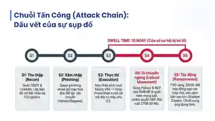
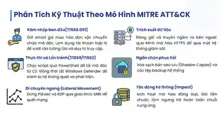
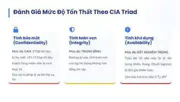
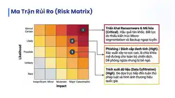
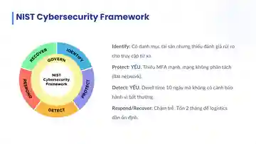
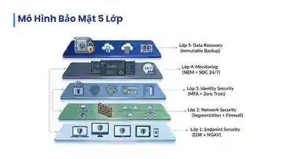

# Asahi Brewery Cyberattack Analysis

**Cybersecurity Case Study · Ransomware Analysis · MITRE ATT&CK · CIA Triad · Risk Assessment · NIST CSF**

> **Project recovery note:** The original computer that stored the project was infected by malware. The original working directory and development files could not be recovered. This portfolio has been reconstructed from the surviving written report, the original 16-slide presentation PDF, and the recorded lab demonstration. It does not claim to restore the missing source code, scripts, VM snapshots, or original network configuration.

## Project deliverables

| Deliverable | Access | Description |
|---|---|---|
| Written report | [Open the report](https://docs.google.com/document/d/1aTacFKg4T68DmGAslC-MS-hgPeNJAvHQ/edit) | Original Google Docs report |
| Presentation | [Open the PDF in this repository](presentations/ASAHI_BREWERY_CYBERATTACK.pdf) | Original 16-slide presentation |
| Lab demo | [Watch the original video](https://drive.google.com/file/d/1euM46GtrGGJ4G-XNy_ITC11I61_uqxKK/view) | Recorded VMware / Kali Linux / Windows 10 demonstration |

The report and demo remain at the original Google Docs / Drive links supplied for the project. Their availability depends on the owner's sharing settings. The presentation PDF is stored directly in this repository.

## Original slide images

The following previews are **direct page renders from the original presentation PDF**, not newly generated or redrawn illustrations. Open the PDF above to view each slide at full resolution.

<table>
  <tr>
    <td width="50%">
      <strong>Slide 6 — Attack Chain</strong> 
      
    </td>
    <td width="50%">
      <strong>Slide 7 — MITRE ATT&CK</strong> 
      
    </td>
  </tr>
  <tr>
    <td width="50%">
      <strong>Slide 8 — CIA Triad</strong> 
      
    </td>
    <td width="50%">
      <strong>Slide 9 — Risk Matrix</strong> 
      
    </td>
  </tr>
  <tr>
    <td width="50%">
      <strong>Slide 10 — NIST Cybersecurity Framework</strong> 
      
    </td>
    <td width="50%">
      <strong>Slide 14 — Five-Layer Security Model</strong> 
      
    </td>
  </tr>
</table>

## Project overview

This academic project studies the ransomware incident involving Asahi Group Holdings as described in the submitted report and presentation. The analysis covers the reported attack chain, selected MITRE ATT&CK techniques, CIA Triad impact, a likelihood-impact risk matrix, NIST Cybersecurity Framework assessment, business impact, and defensive recommendations.

The separate lab recording shows a controlled educational demonstration using VMware Workstation, Kali Linux, and Windows 10 x64. The demo includes a logistics-themed phishing scenario and a custom ransomware proof-of-concept (PoC) display. It is **not Qilin's original malware** and does not reproduce Asahi's production environment.

## Main topics

- **Attack Chain:** reconnaissance, phishing-based initial access, execution, lateral movement, and ransomware impact.
- **MITRE ATT&CK:** technique mapping as presented in the submitted report and slides.
- **CIA Triad:** confidentiality, integrity, and availability impact.
- **Risk Matrix:** likelihood and impact prioritization.
- **NIST Cybersecurity Framework:** assessment and recommendations.
- **Defense-in-Depth:** five-layer defensive model presented in the original slides.
- **Lab evidence:** what can and cannot be confirmed from the surviving demo video.

## Repository structure

~~~text
asahi-brewery-cyberattack-analysis/
├── README.md
├── assets/
│   ├── README.md
│   └── slides/
│       ├── slide-06-attack-chain.webp
│       ├── slide-07-mitre-attack.webp
│       ├── slide-08-cia-triad.webp
│       ├── slide-09-risk-matrix.webp
│       ├── slide-10-nist-csf.webp
│       └── slide-14-defense-in-depth.webp
├── demo/
│   └── README.md
├── docs/
│   ├── README.md
│   ├── attack-chain-and-mitre.md
│   ├── lab-environment.md
│   ├── proposed-infrastructure.md
│   ├── recovery-and-limitations.md
│   ├── risk-assessment.md
│   ├── upload-guide.md
│   └── vmware-workstation-setup.md
├── presentations/
│   ├── README.md
│   └── ASAHI_BREWERY_CYBERATTACK.pdf
└── reports/
    └── README.md
~~~

## Recovery boundaries

The following original artifacts were not recovered:

- Original source code, scripts, and development files.
- VMware VM exports, snapshots, and original VM hardware settings.
- Original VMnet mode, IP addressing, VLAN IDs, routes, and firewall configuration.
- Original SIEM/log-collector configuration and system logs.
- Backup destinations, schedules, isolation settings, and restore-test evidence.

The network and backup details in the documentation are therefore labelled as proposals or rebuild guidance. Example VLAN IDs, IP addresses, VMnet names, and resource allocations must not be described as the original implementation.

The written report's limitations section and the separate surviving demo recording have different scopes. This repository treats the video as a supplementary lab PoC and does not claim that it is a reproduction of the real incident.

## Privacy and responsible use

- The original report contains contributor names and student identification numbers. The public repository links to the source Google Docs document rather than duplicating the unredacted DOCX. Obtain all contributors' agreement before changing its sharing permissions to public access.
- Do not upload the separate IT Infrastructure résumé; it contains personal contact details.
- This is an academic case study based on public information and the team's project materials, not an official Asahi forensic report.
- Incident figures and claims should be read with their original date, definition, and cited source.
- Use the lab demonstration only in an isolated, authorized environment. Do not execute payloads or test against third-party systems.

## Project team

- Tiêu Hoàng Phúc
- Nguyễn Nam Trường
- Nguyễn Phú Đạt

Instructor: ThS. Phan Đình Duy Thông  
Institution: Ho Chi Minh City University of Technology (HUTECH)  
Original report and presentation: 2025
