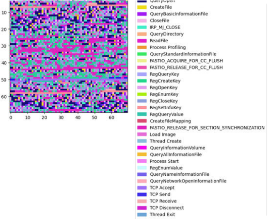
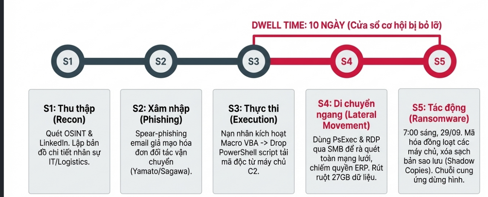

# ⚔️ Attack Chain, MITRE ATT&CK & CIA Triad Analysis

> Detailed breakdown of the September 2025 **Qilin (G1242)** double-extortion ransomware campaign against **Asahi Group Holdings**, mapped across the 5-stage Attack Chain, **MITRE ATT&CK**, and the **CIA Triad**.

---

## 1. Incident & Threat Actor Context

On **September 29, 2025 (07:00 JST)**, Asahi Group Holdings — Japan's largest brewery (~40% domestic beer market share, ~30 domestic plants) — detected simultaneous ransomware encryption across data center servers and endpoints supporting its ERP, Warehouse/Transport Management Systems (WMS/TMS), and factory Operational Technology (OT/MES).

- **Threat Actor:** **Qilin** (also tracked as *Agenda*, MITRE Group ID `G1242`), a Russian-speaking Ransomware-as-a-Service (RaaS) operation active since 2022 using modular **Golang/Rust** encryptors (`XChaCha20`) targeting Windows and VMware ESXi.
- **Initial Foothold:** ~**September 19, 2025** via stolen valid credentials used on network equipment at a Group site.
- **Dwell Time:** ~**10 days** (Sept 19 – Sept 29, 2025), operating primarily outside Japanese business hours to evade detection.
- **Double Extortion:** ~**27 GB** of internal corporate files exfiltrated prior to encryption; Qilin claimed responsibility on **October 7–9, 2025**, publishing 29 sample document images. Asahi refused to pay the ransom.



---

## 2. Five-Stage Attack Chain Analysis



### Stage 1: Reconnaissance (`S1`) — OSINT & Target Profiling

Before breaching the perimeter, attackers conducted structured Open-Source Intelligence (OSINT) to assemble a high-precision target package, followed by 10 days of quiet internal reconnaissance after obtaining initial access:

- **Email & Naming Convention Harvesting:** Extracted hundreds of public corporate emails (`firstname.lastname@asahi.com` and `initial.lastname@asahi.com`) from annual reports, press releases, and public PDFs.
- **Organizational Mapping:** Reconstructed key divisions (*IT Infrastructure Division*, *Supply Chain & Logistics Department*, *Production Control Center*, *Finance & Accounting*) using Asahi's *Integrated Report 2024* and corporate website.
- **Technology Stack Profiling:** Identified centralized SAP-class ERP, integrated WMS/TMS platforms, and perimeter VPN/inter-site router appliances via LinkedIn job postings and recruitment listings.
- **Google Dorking & Passive DNS:**
  - `site:asahigroup-holdings.com filetype:pdf "email" OR "contact"`
  - `"Asahi" "ERP administrator" OR "logistics system"`
  - Subdomain enumeration (`erp.asahi.jp`, `logistics.asahi.co.jp`, `vpn.asahi.group`)
- **Primary Human Targets Identified:**
  1. **IT & Network Administrators** (Network Engineers, SysAdmins) — held VPN/network appliance and data center administrative credentials.
  2. **Supply Chain & Logistics Personnel** (Logistics Coordinators, Warehouse Operators) — processed external shipping documents daily and accessed ERP/WMS workflows.

### Stage 2: Initial Access (`S2`) — Spear-Phishing & Valid Credentials

Per Asahi's official investigation report (November 27, 2025): *"Unauthorized access occurred through network equipment at one of the Group's sites, utilizing stolen credentials."*

- **Partner Impersonation Emails:** Spoofed trusted Japanese logistics carriers (e.g., *Yamato Transport*, *Sagawa Express*) and raw material suppliers with urgent pretexts:
  - *"September 2025 Shipping Invoice Update — Immediate Confirmation Required"*
  - *"Emergency Delivery Schedule Change — Asahi Super Dry"*
- **Weaponized Attachments:** `.docx`, `.xlsm`, and `.zip` archives disguised as September order manifests, shipping contracts, or warehouse inventory reports.
- **Credential Harvesting & MFA Fatigue:** Lookalike Microsoft 365 / VPN login portals (`asahi-login.com`, `asahigroup-secure.net`) with fake CAPTCHA challenges to harvest domain credentials, paired with repeated push prompts (MFA fatigue) where applicable.
- **Outcome:** Attackers authenticated directly into perimeter network equipment at a regional Group site using valid stolen credentials — requiring **zero software vulnerabilities or zero-days**.

### Stage 3: Execution & Persistence (`S3`) — Living-off-the-Land & C2 Staging

Once a targeted user interacted with the lure or an endpoint foothold was established:

1. **VBA Macro Trigger:** Obfuscated macros (Base64 / string concatenation) executed upon clicking *"Enable Content"*.
2. **PowerShell Dropper & AMSI Bypass:** In-memory PowerShell scripts (`Invoke-Obfuscation`) unloaded/patched `amsi.dll` via reflection to evade Windows Defender.
3. **Process Injection:** Masked binaries (`update.exe`, `invoice_processor.dll`) injected into trusted Windows processes (`explorer.exe`, `svchost.exe`).
4. **C2 Channel & Tool Staging:** Outbound HTTPS / DNS tunneling established C2 connectivity to stage browser infostealers, **Mimikatz**, **PsExec**, Cobalt Strike beacons, and the Qilin Golang/Rust encryptor incrementally.
5. **Persistence:** Registry Run keys (`HKCU\...\Run`) and scheduled tasks (e.g., `TVInstallRestore`) ensured survival across reboots.

### Stage 4: Lateral Movement (`S4`) — Flat IT/OT Network Traversal

Across ~10 days of undetected dwell time (primarily off-hours), attackers pivoted from peripheral endpoints into core data center infrastructure:

- **LSASS Credential Dumping:** Executed Mimikatz (`sekurlsa::logonpasswords`) to extract domain admin and service account hashes/passwords.
- **SMB Admin Shares (Port 445):** Used renamed PsExec binaries (e.g., random 8-character names such as `vvvivyyl.exe`) to execute payloads across remote servers via `C$` and `ADMIN$`.
- **RDP Pivoting (Port 3389):** Authenticated interactively into core servers during off-hours using compromised privileged accounts.
- **Internal Discovery & Pivot Path:** Scanned ports `135`, `445`, and `3389` and enumerated Active Directory topologies:
  ```
  User Endpoint ──► Domain Controller / File Server ──► Central ERP / WMS / TMS ──► Plant OT / MES Interfaces
  ```
- **Architectural Weakness:** High IT/OT convergence over a flat internal network allowed lateral reach from a regional site into centralized systems coordinating **30 domestic factories**.

### Stage 5: Exfiltration & Impact (`S5`) — Double Extortion

At approximately **07:00 JST on September 29, 2025**, the attackers executed the final extortion phase:

1. **Pre-Encryption Data Exfiltration:** Transferred ~**27 GB** of internal financial records, contracts, business partner contacts, and employee PII over C2 channels.
2. **Recovery Inhibition:** Stopped database/ERP services (`SQL Server`), tampered with online backups, and wiped Volume Shadow Copies:
   ```cmd
   vssadmin delete shadows /all /quiet
   ```
3. **Simultaneous Ransomware Detonation:** Deployed Qilin's `XChaCha20` encryptor simultaneously across active servers and PCs, appending `.qilin` / random extensions and dropping Tor ransom notes.
4. **Operational Paralysis:** Automated order intake, warehouse dispatch, customer service hotlines, and ERP-linked brewery scheduling collapsed nationwide.

---

## 3. MITRE ATT&CK Technique Mapping

| Stage | MITRE Tactic | Technique ID | Technique Name | Observed / Assessed Behavior in Asahi Incident | Source / Evidence |
| :--- | :--- | :--- | :--- | :--- | :--- |
| **S1** | Reconnaissance | `T1589` / `T1591` | Gather Victim Identity & Org Info | Harvesting employee emails, org charts, ERP/VPN stack from LinkedIn & reports | Qilin TTPs; OSINT analysis |
| **S2** | Initial Access | `T1566.001` | Phishing: Spearphishing Attachment | Spoofed Yamato/Sagawa shipping emails carrying macro-enabled `.docx`/`.xlsm` | Asahi Report (27/11/2025); Check Point |
| **S2** | Initial Access | `T1566.002` | Phishing: Spearphishing Link | Fake Microsoft 365 / VPN portals harvesting employee credentials | Qilin TTPs; Shieldworkz |
| **S2** | Initial Access | `T1078.002` | Valid Accounts: Domain Accounts | Stolen credentials used to log into network equipment at a Group site | Asahi Official Statement |
| **S3** | Execution | `T1204.002` | User Execution: Malicious File | Victim opens disguised logistics attachment and enables macro content | MITRE `S1242`; ThreatLocker |
| **S3** | Execution | `T1059.001` | Command & Scripting: PowerShell | Obfuscated PowerShell loader with AMSI bypass fetching Qilin dropper | Qilin Technical Analysis |
| **S3** | Persistence | `T1547.001` | Registry Run Keys / Startup Folder | Autostart registry entries maintaining access across host reboots | AttackIQ; MITRE `G1242` |
| **S3** | Persistence | `T1053.005` | Scheduled Task/Job: Scheduled Task | Creation of scheduled tasks (e.g., `TVInstallRestore`) for recurring execution | Qilin TTPs |
| **S3** | Defense Evasion | `T1562.001` | Impair Defenses: Disable/Modify Tools | Disabling Windows Defender / endpoint security agents prior to encryption | Multi-source RaaS telemetry |
| **S4** | Credential Access | `T1003.001` | OS Credential Dumping: LSASS Memory | Dumping cleartext/hash credentials from LSASS via Mimikatz variants | Check Point Research |
| **S4** | Lateral Movement | `T1021.002` | Remote Services: SMB/Windows Admin Shares | Renamed PsExec pivoting over port 445 (`ADMIN$`, `C$`) across servers | ThreatLocker; ~10-day dwell time |
| **S4** | Lateral Movement | `T1021.001` | Remote Services: RDP | Off-hours interactive RDP sessions (`3389`) using domain admin accounts | Qilin Affiliate Patterns |
| **S5** | Exfiltration | `T1041` | Exfiltration Over C2 Channel | ~27 GB of internal documents and contact records exfiltrated pre-encryption | Qilin Leak Site; Asahi (02/2026) |
| **S5** | Defense Evasion / Impact | `T1490` | Inhibit System Recovery | Deleting Volume Shadow Copies (`vssadmin`) and tampering with online backups | Asahi Investigation |
| **S5** | Impact | `T1486` | Data Encrypted for Impact | Simultaneous `XChaCha20` encryption across data center servers & endpoints | Asahi Disclosure (29/09/2025) |
| **S5** | Impact | `T1499` | Endpoint Denial of Service *(indirect)* | Production, ERP, and logistics outage resulting from mass encryption | Nationwide operational halt |

### Analytical Takeaways from MITRE Mapping

1. **Zero Zero-Days Required:** Every technique in the chain relied on credential abuse, social engineering, and Living-off-the-Land Binaries (LOLBins) rather than unpatched zero-day exploits.
2. **Identity & Detection Blind Spots:** Relying on static passwords/bypassable MFA (`T1078.002`) and lacking behavioral EDR (`T1059.001`, `T1003.001`, `T1021.002`) gave attackers 10 full days to map and stage encryption across the enterprise.
3. **Classic Double Extortion:** Combining `T1041` (27 GB theft) with `T1486` + `T1490` maximized financial and regulatory pressure even after Asahi refused ransom payment.

---

## 4. CIA Triad Impact Assessment

| CIA Pillar | Impact Rating | Technical Evidence | Primary Business Consequence |
| :--- | :--- | :--- | :--- |
| **Confidentiality** | 🟠 **High** | ~27 GB exfiltrated; **1,914,000 records** initially assessed at risk (Nov 2025); **115,513 records confirmed leaked** (Feb 2026: 110,396 business partner executive contacts + 5,117 employee records) | Regulatory exposure under Japan's **APPI**, notification/legal costs, heightened follow-on phishing risk |
| **Integrity** | 🟡 **Medium** | Qilin encrypted files without silently altering underlying business figures, but deleted Volume Shadow Copies, tampered with online backups, and disrupted audit logging | Loss of clean online restore points; temporary distrust of system state requiring full environment rebuild |
| **Availability** | 🔴 **Critical** | Simultaneous encryption of ERP, WMS/TMS, and OT-linked systems at 07:00 JST Sept 29; 30 plants halted/curtailed; ~2 months manual paper/fax fallback; ~4 months until logistics normalized | Severe nationwide *Asahi Super Dry* shortage across 52,000+ retail outlets; −4% annual domestic beer volume; ¥10–15B total estimated financial impact |

> [!IMPORTANT]
> **Why Availability Dominated:** In highly automated, just-in-time beverage manufacturing, tight coupling between central ERP/logistics and 30 factory production lines meant IT downtime immediately halted physical goods movement — turning an Availability failure into ~¥118 million/hour of disrupted revenue exposure.

---

## Related Documentation

- **Next:** [Risk Assessment, NIST CSF 2.0 & Business Impact](risk-assessment.md)
- **Defense Architecture:** [Proposed 5-Layer Defense-in-Depth Infrastructure](proposed-infrastructure.md)
- **Back to Index:** [Documentation Index](README.md)
