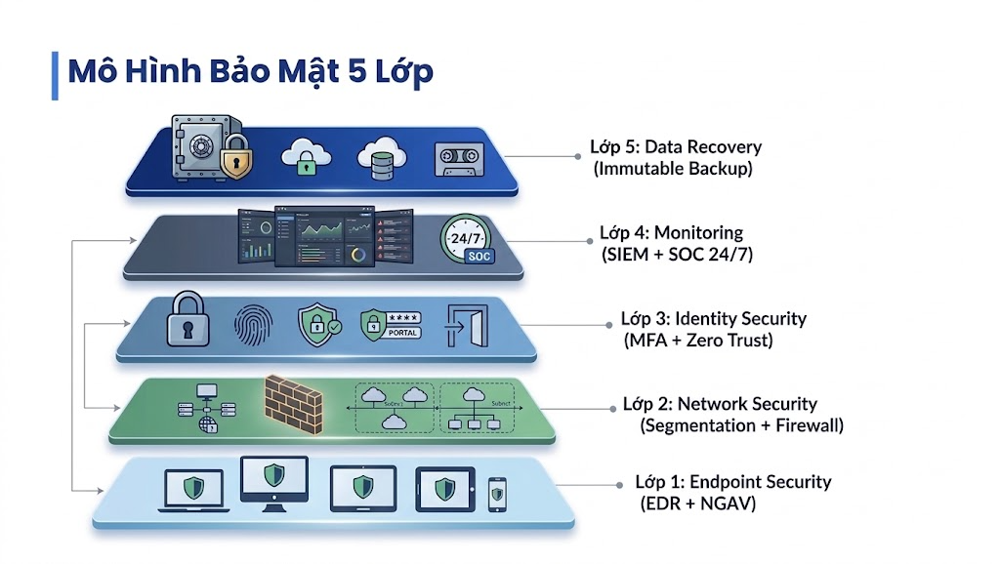
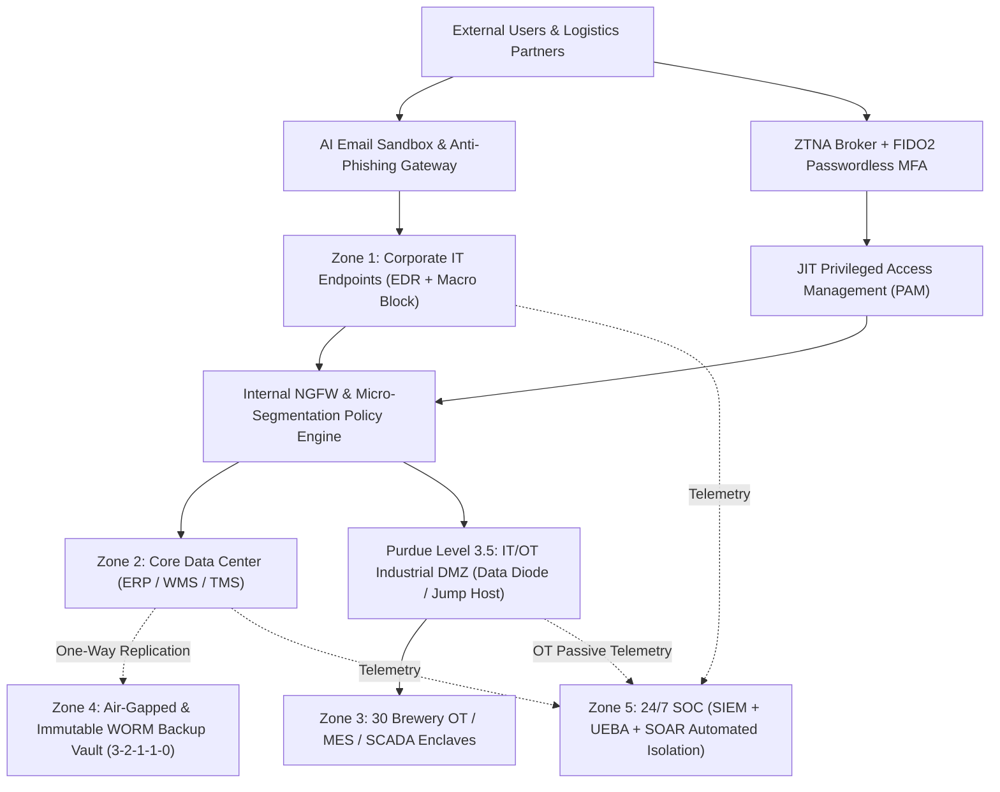

# 🛡️ Proposed Defense-in-Depth Security Infrastructure

> Actionable 5-layer **Defense-in-Depth** and **Zero-Trust** target architecture designed to remediate the root causes of the Asahi Group Holdings ransomware incident across corporate IT, data center ERP, and 30 factory OT environments.

---

## 1. Architectural Design Principles

The Asahi incident demonstrated that a single stolen credential on a perimeter network device could cascade into a 30-factory operational shutdown because of four compounding failures: **phishable authentication**, **flat IT/OT network connectivity**, **10 days of unmonitored endpoint/lateral activity**, and **mutable online backups**.

The proposed target infrastructure enforces four core engineering principles:
1. **Assume Breach & Zero-Trust Access:** Replace implicit LAN trust and legacy VPN tunnels with identity- and device-verified **Zero-Trust Network Access (ZTNA)** and strict **IT/OT micro-segmentation**.
2. **Phishing-Resistant Identity:** Eliminate password/push-MFA phishing and static admin credentials via **FIDO2/WebAuthn** and **Just-In-Time (JIT) PAM**.
3. **Behavioral Detection & Automated Containment:** Detect LOLBins, LSASS access, and SMB pivoting in minutes via **EDR + SIEM/UEBA**, cutting isolation time from 4 hours to **<15 minutes** via **SOAR**.
4. **Guaranteed Clean Recovery:** Enforce **3-2-1-1-0 immutable WORM and air-gapped backups** so ransomware encryption cannot exceed a 4-hour Recovery Time Objective (RTO).

---

## 2. Five-Layer Defense-in-Depth Model

### Target Segmented Network & Security Topology

---

## 3. Layer-by-Layer Technical Controls

### Layer 1: Endpoint Security (`Endpoint`)
- **Enterprise EDR / NGAV Deployment:** Roll out behavioral EDR (*CrowdStrike Falcon* or *Microsoft Defender for Endpoint*) across 100% of workstations and Windows/Linux/ESXi servers.
- **Attack Surface Reduction (ASR):**
  - Block Office VBA macros in documents originating from the internet (neutralizes `T1566.001` / `T1204.002`).
  - Enforce PowerShell Constrained Language Mode, Script Block Logging, and tamper-protected AMSI (`T1059.001`).
  - Enable Credential Guard / LSA RunAsPPL to block `lsass.exe` memory dumping via Mimikatz (`T1003.001`).
  - Enable Tamper Protection to prevent attackers from disabling security sensors pre-encryption (`T1562.001`).

### Layer 2: Network & IT/OT Segmentation (`Network`)
- **IT/OT Separation (Purdue Model Level 3.5 IDMZ):** Decouple corporate IT and central ERP networks from the 30 brewery **MES/SCADA/PLC** environments using an Industrial DMZ, strict allowlisted broker APIs, and unidirectional gateways where feasible — ensuring factories can continue localized batch execution even if corporate ERP is isolated.
- **Micro-Segmentation:** Deploy host/workload micro-segmentation (*Illumio* or *Cisco Secure Workload*) to block workstation-to-workstation and unauthorized workstation-to-server **SMB (`445`)** and **RDP (`3389`)** traffic (`T1021.001`, `T1021.002`).
- **ZTNA Over Legacy VPN:** Replace exposed site VPN appliances with ZTNA continuous posture verification and strict egress filtering (blocking unauthorized Tor/C2/file-sharing destinations).

### Layer 3: Identity & Privileged Access (`Identity`)
- **FIDO2 / WebAuthn Passwordless MFA:** Mandate hardware security keys or platform passkeys for all IT administrators, VPN/ZTNA users, and ERP/Logistics operators — neutralizing fake M365/VPN credential-harvesting portals and MFA push fatigue (`T1566.002`, `T1078.002`).
- **Privileged Access Management (PAM):** Vault all Domain Admin, ESXi, database, and network-equipment credentials with **Just-In-Time (JIT)** ephemeral elevation, session recording, and automated password rotation.
- **Tiered Active Directory Administration:** Strictly separate Tier-0 (Domain Controllers / Identity), Tier-1 (ERP / Servers), and Tier-2 (User Workstations) accounts so workstation compromise cannot yield Domain Admin hashes.

### Layer 4: Continuous Monitoring, Detection & DLP (`Monitoring`)
- **24/7 SOC + SIEM & UEBA:** Centralize endpoint, AD, firewall, VPN/ZTNA, and ERP logs into a SIEM paired with User and Entity Behavior Analytics (UEBA) to alert immediately on:
  - Off-hours administrative logins and abnormal internal port scanning (`135`, `445`, `3389`)
  - Renamed `PsExec` service installations and remote WMI/SMB execution
  - Anomalous outbound data transfers (>GB thresholds) indicative of C2 exfiltration (`T1041`)
- **SOAR Automated Containment:** Pre-authorize SOAR playbooks to quarantine compromised hosts, revoke active tokens, and sever site WAN links within **<15 minutes** (eliminating the 4-hour 07:00→11:00 JST isolation gap).
- **Email & Data Loss Prevention (DLP):** Deploy *Microsoft Defender for Office 365* (or equivalent AI email detonation sandbox + DMARC/DKIM/SPF enforcement) for inbound partner mail, plus endpoint/network DLP & CASB for sensitive PII and financial repositories.

### Layer 5: Resilient Backup & Disaster Recovery (`Recovery`)
- **3-2-1-1-0 Backup Architecture:**
  - **3** copies of critical ERP, WMS/TMS, AD, and OT configuration data
  - **2** distinct storage media types
  - **1** offsite replica
  - **1** **immutable (WORM / Object Lock)** and **offline air-gapped** vault inaccessible from Active Directory credentials (defeating `T1490` backup tampering)
  - **0** unverified recovery errors via automated integrity checks
- **Quarterly Clean-Room Restore Drills:** Validate full bare-metal/VM restoration of Active Directory, SAP/ERP, and WMS/TMS within target RTO/RPO, paired with digital-free fallback SOPs for warehouse dispatch.

---

## 4. Organizational & Governance Controls

| Control Domain | Actionable Program |
| :--- | :--- |
| **Role-Specific Phishing Training** | Monthly simulated spear-phishing exercises tailored to **Supply Chain/Logistics** (fake carrier invoices) and **IT Operations** (fake VPN/MFA alerts) |
| **Ransomware Incident Response Plan (IRP)** | Codified ransomware playbook defining immediate OT decoupling triggers, legal/APPI breach notification workflows, and semi-annual executive tabletop exercises |
| **Third-Party & Carrier Verification** | Out-of-band verification procedures for bank/invoice template changes from logistics partners (*Yamato*, *Sagawa*, raw material vendors) |
| **Vulnerability & Appliance Governance** | Continuous external attack surface management (EASM) and 72-hour critical patching SLAs for edge routers, firewalls, and VPN gateways |

---

## 5. Before vs. After Architecture Comparison

| Security Dimension | Pre-Incident State (Sept 2025) | Proposed Target State | Maturity Shift |
| :--- | :--- | :--- | :--- |
| **Authentication** | Static passwords + bypassable MFA; credential reuse | FIDO2/WebAuthn passwordless MFA + JIT PAM + AD Tiering | Medium → **Excellent** |
| **Endpoint Protection** | Traditional signature AV; no behavioral EDR | Enterprise EDR/NGAV + ASR macro/LOLBin blocking + LSA protection | None → **Critical** |
| **Network Topology** | Flat IT/OT network; exposed site VPN appliances | Micro-segmentation + ZTNA + Purdue Level 3.5 IT/OT IDMZ | High Risk → **Low Risk** |
| **Threat Detection** | Blind spot across **10-day dwell time** | 24/7 SOC + SIEM/UEBA real-time behavioral & off-hours alerting | Weak → **Strong** |
| **Incident Response** | Manual, **~4 hours** to begin network isolation | Rehearsed ransomware playbook + SOAR automated containment (**<15 min**) | Slow → **Rapid (<1h)** |
| **Backup & Recovery** | Online backups & Shadow Copies wiped; ~2–4 mo outage | **3-2-1-1-0** Immutable WORM + Air-Gapped Vault + quarterly drills | Fragile → **Assured** |

---

## Related Documentation

- **Previous:** [Risk Assessment, NIST CSF 2.0 & Business Impact](risk-assessment.md)
- **Lab Validation:** [Lab Environment](lab-environment.md) · [VMware Workstation Setup](vmware-workstation-setup.md)
- **Back to Index:** [Documentation Index](README.md)
