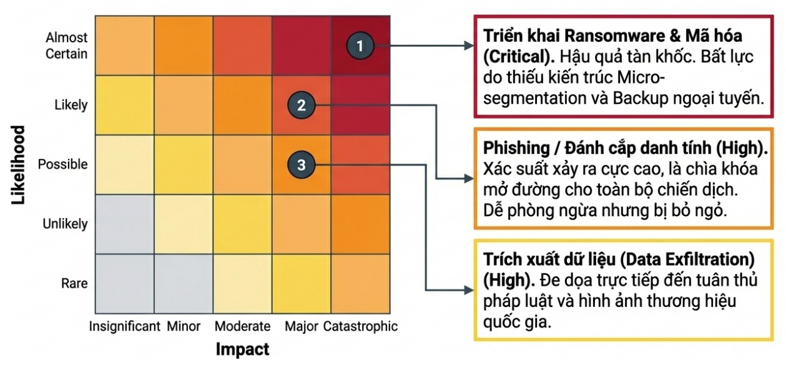
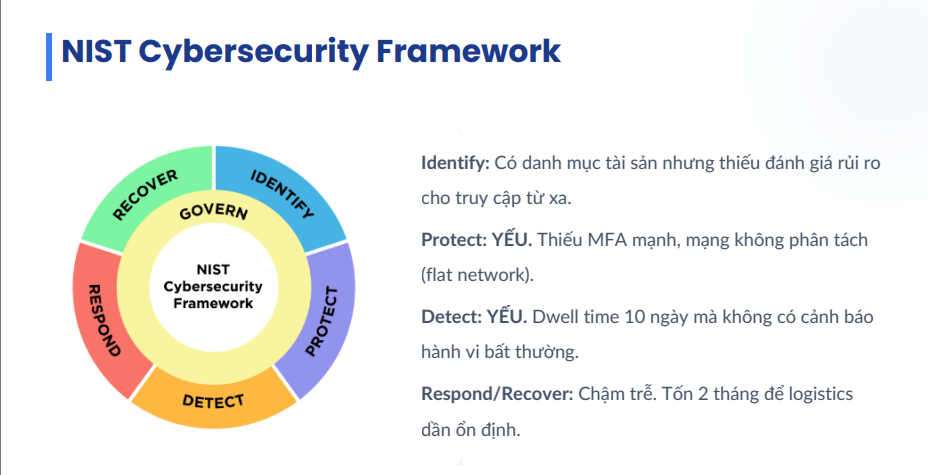
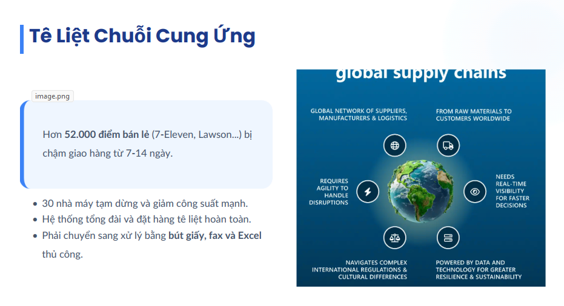
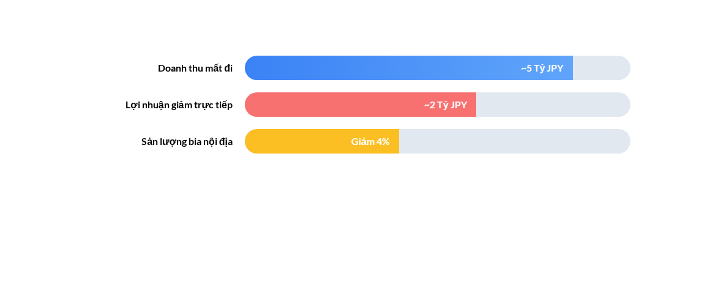

# 📊 Risk Assessment, NIST CSF 2.0 & Business Impact

> Qualitative enterprise risk assessment, 5×5 Risk Matrix prioritization, **NIST Cybersecurity Framework (CSF 2.0)** maturity gap analysis, and multi-dimensional business impact evaluation of the Asahi Group Holdings ransomware incident.

---

## 1. Qualitative Risk Assessment Methodology

Enterprise risk across the Asahi attack lifecycle is evaluated using the standard qualitative model:

$$\text{Risk} = \text{Threat} \times \text{Vulnerability} \times \text{Impact}$$

- **Threat:** Frequency and capability of the adversary (Qilin `G1242` actively targeting Japanese manufacturing and supply-chain enterprises in 2025).
- **Vulnerability:** Severity of pre-incident architectural and procedural weaknesses (e.g., lack of behavioral EDR, flat IT/OT network, non-immutable backups).
- **Impact:** Operational, financial, regulatory, and reputational damage upon exploitation.

### Threat–Vulnerability–Impact Breakdown

| Threat Scenario | Exploited Vulnerability | Impact | Overall Risk | Analytical Rationale |
| :--- | :--- | :--- | :--- | :--- |
| **Phishing / Spear-Phishing** | Insufficient phishing training; weak email sandboxing | High *(initial foothold)* | 🟠 **High** | Primary entry vector: spoofed logistics emails targeting staff who process external invoices daily |
| **Credential Theft & Abuse** | Password reuse; lack of phishing-resistant MFA (FIDO2) | Medium–High *(perimeter breach)* | 🟠 **High** | Stolen valid credentials allowed direct login to site network equipment without triggering exploit alerts |
| **Malware / Script Execution** | No real-time behavioral EDR/NGAV; AMSI bypass unblocked | High *(C2 establishment)* | 🔴 **Critical** | Obfuscated PowerShell and process-injected droppers established C2 and staged post-exploitation tools unchecked |
| **Lateral Movement** | Flat IT/OT network (no micro-segmentation); LSASS dumping | High *(enterprise-wide reach)* | 🟠 **High** | 10-day dwell time enabled unrestricted pivoting from site endpoint to central ERP, databases, and 30 plants |
| **Ransomware Deployment** | Online backups & Shadow Copies mutable; no OT isolation | Critical *(system-wide outage)* | 🔴 **Critical** | Simultaneous encryption paralyzed order intake, logistics, and brewery scheduling nationwide |
| **Data Exfiltration** | Absence of DLP and outbound C2 anomaly alerting | High *(APPI & brand damage)* | 🟠 **High** | 27 GB exfiltrated and 115,513 records confirmed leaked prior to ransomware detonation |

---

## 2. 5×5 Risk Matrix & Remediation Priority

### Standard 5×5 Likelihood × Impact Matrix

| Likelihood \ Impact | Insignificant | Minor | Moderate | Major | Catastrophic |
| :--- | :---: | :---: | :---: | :---: | :---: |
| **Almost Certain** | Medium | High | High | 🔴 **Critical** | 🔴 **Critical** |
| **Likely** | Medium | Medium | High | 🟠 **High** | 🔴 **Critical** |
| **Possible** | Low | Medium | Medium | 🟠 **High** | 🟠 **High** |
| **Unlikely** | Low | Low | Medium | Medium | High |
| **Rare** | Low | Low | Low | Medium | Medium |

### Asahi Incident Risk Mapping & Priority Tiers

| Risk Item | Likelihood | Impact | Matrix Rating | Remediation Priority & Immediate Action |
| :--- | :--- | :--- | :--- | :--- |
| **Ransomware Deployment** | Likely | Catastrophic | 🔴 **Critical** | **Priority 1:** Deploy 3-2-1-1-0 immutable/air-gapped WORM backups, enterprise EDR, and IT/OT network isolation to cap future recovery RTO at <4 hours |
| **Malware / LOLBin Execution** | Likely | Major–Catastrophic | 🔴 **Critical** | **Priority 1:** Enforce behavioral EDR/NGAV, block Office VBA macros from the internet, and harden PowerShell/AMSI |
| **Phishing & Credential Theft** | Likely | Major | 🟠 **High** | **Priority 2:** Roll out FIDO2/WebAuthn passwordless MFA, AI email sandboxing, dark-web credential monitoring, and monthly phishing drills |
| **Lateral Movement** | Possible → Likely | Major | 🟠 **High** | **Priority 2:** Implement micro-segmentation, Just-In-Time (JIT) Privileged Access Management (PAM), and SMB/RDP restrictions |
| **Data Exfiltration** | Possible | Major | 🟠 **High** | **Priority 3:** Deploy endpoint/network DLP, CASB, outbound traffic volume alerting, and encryption at rest |

---

## 3. NIST Cybersecurity Framework (CSF 2.0) Gap Analysis

Mapping Asahi's pre-incident posture against all six **NIST CSF 2.0 (2024)** functions highlights concentrated maturity failures in **Protect**, **Detect**, **Respond**, and **Recover**:

| CSF 2.0 Function | Pre-Incident Maturity | Observed Gap in Asahi Incident | Target Remediation |
| :--- | :--- | :--- | :--- |
| **Govern (GV)** | ⚠️ **Medium** | Security policies existed on paper, but enforcement of phishing resilience, credential hygiene audits, and supply-chain cyber risk oversight lagged | Board-level cyber risk reporting, mandatory quarterly IT/Logistics training, and periodic third-party/credential audits |
| **Identify (ID)** | ✅ **Adequate** | Enterprise asset inventory covered 30 plants, data centers, and ERP/WMS, but lacked deep risk scoring for remote-access network appliances and IT/OT dependencies | Continuous exposure assessment of VPN/router appliances and criticality tiering of ERP-to-OT interfaces |
| **Protect (PR)** | ❌ **Weak** | Password reuse and phishable MFA; absence of PAM; flat IT/OT network architecture; unsegmented administrative shares | Zero-Trust Network Access (ZTNA), FIDO2 MFA, JIT PAM, micro-segmentation, and rapid network appliance patching |
| **Detect (DE)** | ❌ **Weak** | **Most severe pre-incident gap:** 10-day dwell time (Sept 19–29) with zero alerts on obfuscated PowerShell, Mimikatz LSASS dumps, PsExec SMB pivoting, or off-hours RDP/C2 | 24/7 SOC backed by EDR/XDR + SIEM + UEBA behavioral analytics tuned for LOLBins and off-hours privilege anomalies |
| **Respond (RS)** | ⚠️ **Slow** | Encryption detected at **07:00 JST** on Sept 29, but network isolation only began at **11:00 JST (~4-hour delay)**; lacked rehearsed ransomware containment automation | Pre-authorized ransomware IR playbooks, SOAR automated host/VLAN isolation (<15 min MTTR), and semi-annual tabletop exercises |
| **Recover (RC)** | ❌ **Weak** | Online backups and Volume Shadow Copies wiped (`vssadmin delete shadows /all /quiet`); forced ~2 months of manual operations and >4 months for full logistics recovery | Immutable WORM + offline air-gapped backups (`3-2-1-1-0`), documented manual continuity SOPs, and quarterly restore drills |

---

## 4. Multi-Dimensional Business Impact Analysis

### 4.1 Supply Chain & Operational Impact

The attack caused the most severe domestic operational disruption in Asahi's **136-year history**, striking its core **Japan & East Asia** segment (~49.7% of global revenue):

- **Order & Logistics Paralysis:** From 07:00 JST on September 29 through late November 2025, central ERP, WMS, and TMS platforms were offline. Staff across **300+ locations** reverted to **paper forms, fax machines, and standalone Excel spreadsheets**.
- **Retail & Distribution Bottlenecks:** Over **2,000 delivery trucks** lost automated dispatch schedules; **52,000+ retail points** (*7-Eleven*, *FamilyMart*, *Lawson*, *Aeon*, bars, and vending networks) suffered **7–14 day delivery delays**.
- **Brewery Shutdowns:** Virtually all **30 domestic factories** — including the **6 core beer breweries** (*Sapporo, Motomiya, Moriya, Nagoya, Suita, Hakata*) — halted or sharply curtailed output.
- **Phased Recovery Trajectory:**
  - *Early October 2025:* Manual production restarted at **10–25% capacity** during the first 3 weeks.
  - *October 2025 Sales Drop:* Asahi Breweries dropped to the low-80% YoY range; Asahi Soft Drinks fell ~60%; Asahi Group Foods dropped >70% in select lines.
  - *December 2025:* Output reached **70–80%** of pre-incident levels.
  - *February 2026:* Logistics gradually normalized (~4 months post-attack), though select soft-drink/chu-hi SKUs remained constrained into March 2026.
  - *Full-Year Volume:* Domestic beer volume fell **−4% in 2025**, a 10+ year record low.

### 4.2 Financial Impact

Total direct and indirect losses substantially exceeded Qilin's ~$10M ransom demand (which Asahi refused to pay):

$$\text{Downtime Cost} = \text{Average Hourly Revenue} \times \text{Disruption Hours} \times \text{Impact Ratio}$$

- **Baseline Segment Scale:** Japan & East Asia 9M 2025 revenue totaled **¥1,030 billion** (~$6.46B USD), equating to **~¥118 million/hour** across 24/7 operations.
- **Disruption Window:** ~120 days of degraded production/logistics at a 65–75% weighted operational impact ratio.

| Financial Impact Category | Reported / Estimated Impact |
| :--- | :--- |
| **Direct Downtime Revenue Loss** *(official, Feb 26, 2026)* | **~¥5.0 billion** (~$31.4M USD) |
| **Direct Downtime Operating Profit Drop** *(official)* | **~¥2.0 billion** (~$12.6M USD) |
| **Incident Response, Forensics & Legal Notification** *(Rescana, Deloitte, ~1.9M notices)* | **~¥300–500 million** |
| **Infrastructure Rebuild, Zero-Trust & EDR Rollout** | **Multi-billion ¥** capital/operating expenditure |
| **Total Direct + Indirect Loss Estimate** | **¥10–15 billion (~$63–94M USD)** |
| **Japan & East Asia Segment Profit** | **−3.1% YoY** (to ¥100.0B) |
| **Global Core Operating Profit** | **−4.6% YoY** (to ¥202.4B despite +0.6% global revenue) |
| **Commercial Opportunity Cost** | Market share lost to *Kirin* & *Suntory*; **3+ new product launches delayed** (including *Asahi Gold*); Q3 financial filing delayed to March 10, 2026 |

### 4.3 Reputational, Regulatory & Data Impact

- **Brand Erosion:** *Asahi Super Dry* — a flagship Japanese consumer brand — suffered empty shelves nationwide, driving consumers and izakaya/bar operators toward rival breweries.
- **Confirmed Data Breach Breakdown:** Out of **1.914 million records** initially placed under investigation (including 1.525M customer service records), Asahi confirmed on **February 18, 2026** that **115,513 records** were actually exposed:
  - **110,396** business partner executive contact records
  - **5,117** Asahi employee records
  - *(No payment card numbers were exposed, and no widespread public dump beyond initial dark-web samples was observed.)*
- **Regulatory Exposure:** Notification duties, regulatory scrutiny, and potential administrative/civil liability under Japan's **Act on the Protection of Personal Information (APPI)**.

---

## Related Documentation

- **Previous:** [Attack Chain, MITRE ATT&CK & CIA Triad](attack-chain-and-mitre.md)
- **Next:** [Proposed 5-Layer Defense-in-Depth Infrastructure](proposed-infrastructure.md)
- **Back to Index:** [Documentation Index](README.md)
